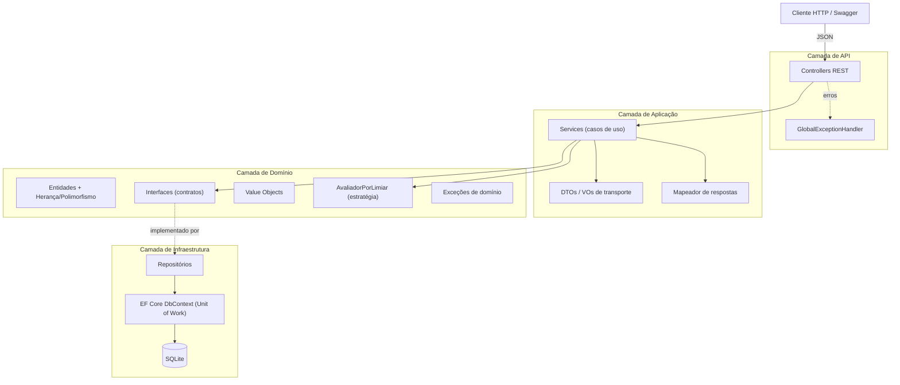
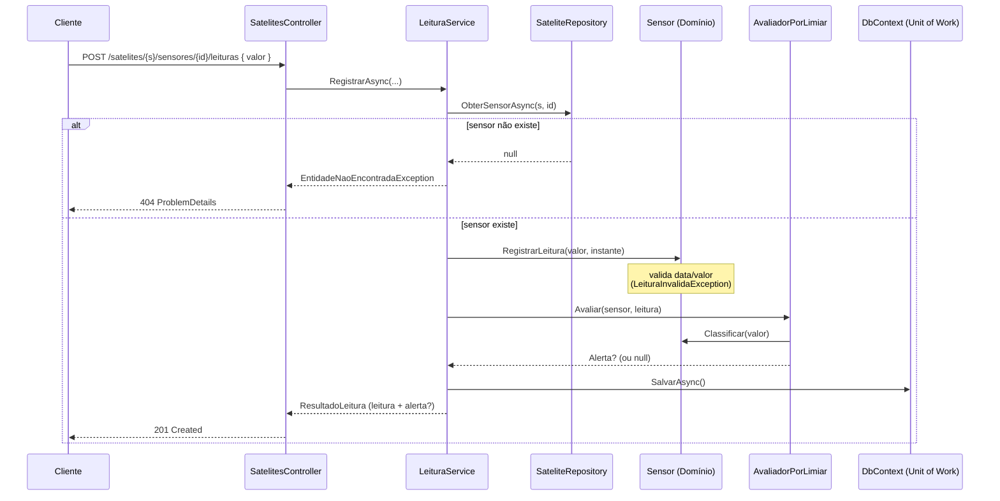

# Monitoramento Orbital API — Global Solution

WebService REST (ASP.NET Core / .NET 10) para **monitoramento de uma constelação de satélites**, suas leituras de sensores e a **geração automática de alertas** quando grandezas críticas (radiação, temperatura, bateria, proximidade de detritos) cruzam limiares de segurança.

> Disciplina: **SOA e WebServices** — entrega da Global Solution.

### Integrantes

- Fabricio Bettarello — RM 554638
- Enzo Miletta — RM 98677
- Vitor Victorino Couto — RM 554965

---

## 1. Motivação

A órbita terrestre está cada vez mais congestionada: milhares de satélites ativos convivem com lixo espacial, tempestades solares e variações térmicas extremas. Uma falha não detectada a tempo pode significar a perda de um satélite de milhões de dólares ou a interrupção de serviços essenciais (comunicação, previsão do tempo, observação de desastres naturais).

**Sistemas espaciais críticos não podem quebrar abruptamente.** Este projeto simula o núcleo de um centro de controle de operações: ele recebe leituras telemétricas dos sensores embarcados, avalia cada leitura contra limiares configuráveis e emite alertas classificados por severidade, mantendo um histórico temporal consultável para análise posterior.

### Como se integra

A aplicação é exposta como um **WebService REST autodescritivo (Swagger/OpenAPI)**. Qualquer cliente — um painel de operações, um simulador de telemetria, um satélite real enviando dados, ou outro microsserviço — consome os endpoints HTTP para:

- cadastrar satélites e acoplar sensores;
- enviar leituras (que disparam a avaliação de alertas em tempo real);
- consultar o histórico de alertas por período e severidade;
- reconhecer alertas tratados pela equipe.

Os dados são persistidos em **SQLite** via Entity Framework Core, tornando a execução e a verificação simples (banco em arquivo, criado automaticamente na primeira execução).

---

## 2. Arquitetura

O projeto segue uma arquitetura em camadas, com dependências apontando sempre para o domínio (Dependency Inversion):



### Fluxo principal — registro de leitura e geração de alerta



---

## 3. Estrutura de pastas

```
MonitoramentoOrbital.Api/
├── Domain/                     # Núcleo de negócio (sem dependências externas)
│   ├── Common/                 # EntidadeBase (classe abstrata raiz)
│   ├── Entities/               # Satelite (abstrata) + 3 tipos concretos, Sensor, Leitura, Alerta
│   ├── Enums/                  # TipoSensor, SeveridadeAlerta, StatusSatelite, DirecaoLimite
│   ├── ValueObjects/           # Coordenada (VO imutável)
│   ├── Exceptions/             # DominioException, EntidadeNaoEncontrada, LeituraInvalida
│   ├── Interfaces/             # IRepository<T>, ISateliteRepository, IAlertaRepository, IUnitOfWork, IAvaliadorAlerta
│   └── Services/               # AvaliadorPorLimiar (estratégia de alerta)
├── Application/                # Casos de uso e orquestração
│   ├── DTOs/                   # Requests e Responses (records imutáveis)
│   ├── Mapeamento/             # MapeadorResposta (entidade -> DTO)
│   └── Services/               # SateliteService, LeituraService, AlertaService (+ interfaces)
├── Infrastructure/             # Detalhes técnicos
│   ├── Data/                   # MonitoramentoDbContext, SeedData
│   └── Repositories/           # Repository<T>, SateliteRepository, AlertaRepository
├── Api/Middleware/             # GlobalExceptionHandler
├── Controllers/                # SatelitesController, AlertasController
└── Program.cs                  # Composição / Injeção de Dependência
```

---

## 4. Como executar

Pré-requisito: **.NET SDK 10**.

```bash
# a partir da raiz do repositório
dotnet run --project MonitoramentoOrbital.Api
```

Na primeira execução o banco `monitoramento.db` é criado e populado automaticamente (3 satélites com sensores).

- API: `http://localhost:5115`
- **Swagger UI**: `http://localhost:5115/swagger`

---

## 5. Endpoints

| Método | Rota | Descrição |
|--------|------|-----------|
| GET    | `/api/satelites` | Lista satélites (ordenados por prioridade de monitoramento) |
| GET    | `/api/satelites/{id}` | Detalha um satélite e seus sensores |
| POST   | `/api/satelites` | Cadastra satélite (`tipo`: 1=Observação, 2=Comunicação, 3=Meteorológico) |
| PATCH  | `/api/satelites/{id}/status` | Atualiza status operacional |
| PATCH  | `/api/satelites/{id}/posicao` | Reposiciona o satélite |
| POST   | `/api/satelites/{id}/sensores` | Acopla um sensor |
| POST   | `/api/satelites/{s}/sensores/{id}/leituras` | Registra leitura (pode gerar alerta) |
| GET    | `/api/alertas` | Lista alertas recentes |
| GET    | `/api/alertas/historico?inicio&fim&severidadeMinima` | Histórico filtrado por período/severidade |
| POST   | `/api/alertas/{id}/reconhecer` | Marca alerta como reconhecido |

---

## 6. Mapeamento dos critérios de avaliação

| Critério | Onde está no código |
|----------|---------------------|
| Classes públicas / privadas / estáticas | `MapeadorResposta` (estática); membros `private`/`protected` nas entidades |
| Herança | `Satelite` (abstrata) → `SateliteObservacao`, `SateliteComunicacao`, `SateliteMeteorologico` |
| Polimorfismo | `DescreverMissao()`, `PrioridadeBase()`, `PrioridadeMonitoramento()` (sobrescrito em `SateliteMeteorologico`) |
| Classes abstratas | `EntidadeBase`, `Satelite` |
| Interfaces + Injeção de Dependência | `Domain/Interfaces/*` registrados em `Program.cs`; `IAvaliadorAlerta` trocável |
| Métodos / fluxo / DateTime | `LeituraService.RegistrarAsync`, `AlertaService.ConsultarAsync` (janela temporal), `Leitura.Defasagem()`, `Satelite.AnosEmOrbita()` |
| Tratamento de exceções | `GlobalExceptionHandler` + exceções específicas de domínio |
| VO / DTO | `Coordenada` (Value Object imutável); `*Request`/`*Response` (DTOs como `record`) |
| Conexão com banco | EF Core + SQLite (`MonitoramentoDbContext`) |
| WebService / API | Controllers REST + Swagger/OpenAPI |

---

## 7. Evidências de execução

Saídas reais coletadas com a API em execução (`dotnet run`). Veja também [docs/EVIDENCIAS.md](docs/EVIDENCIAS.md) para o log completo.

**Geração de alerta a partir de leitura crítica** (radiação 95 mSv ≥ limite crítico 90):

```json
POST /api/satelites/2/sensores/5/leituras  { "valor": 95 }
{
  "leitura": { "id": 2, "valor": 95, "classificacao": "Emergencia" },
  "alertaGerado": {
    "sateliteNome": "GOES-16",
    "severidade": "Emergencia",
    "mensagem": "Sensor de Radiacao registrou 95,00 mSv (atencao >= 40,00, critico >= 90,00)."
  }
}
```

**Tratamento de exceção** (data de leitura no futuro → HTTP 422):

```json
{
  "title": "Leitura invalida",
  "status": 422,
  "detail": "A data da leitura (2099-01-01 00:00:00Z) nao pode estar no futuro."
}
```

**Sensor com direção crítica invertida** (bateria 10% ≤ limite 15% → Emergência), demonstrando que o domínio entende que para bateria/proximidade *quanto menor, pior*:

```json
{ "severidade": "Emergencia",
  "mensagem": "Sensor de Bateria registrou 10,00 % (atencao <= 30,00, critico <= 15,00)." }
```
